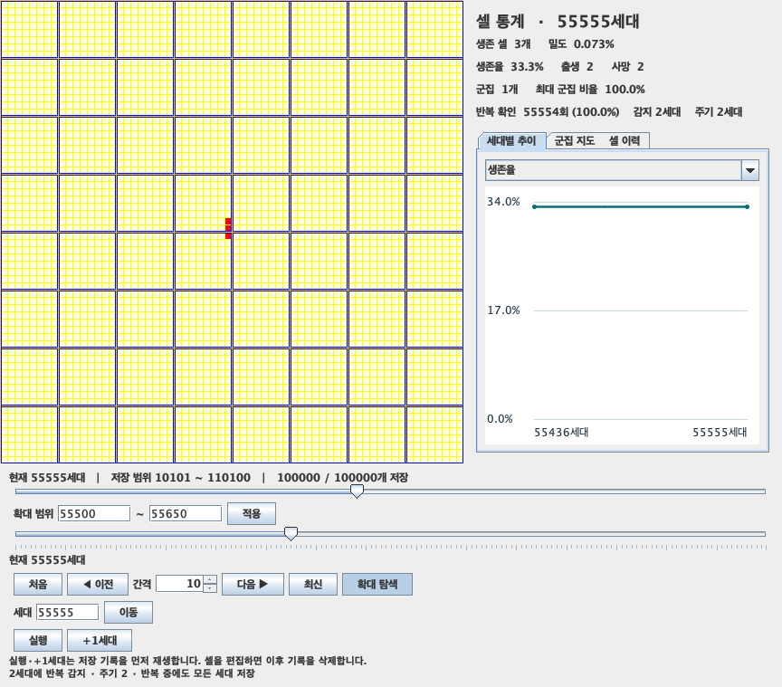
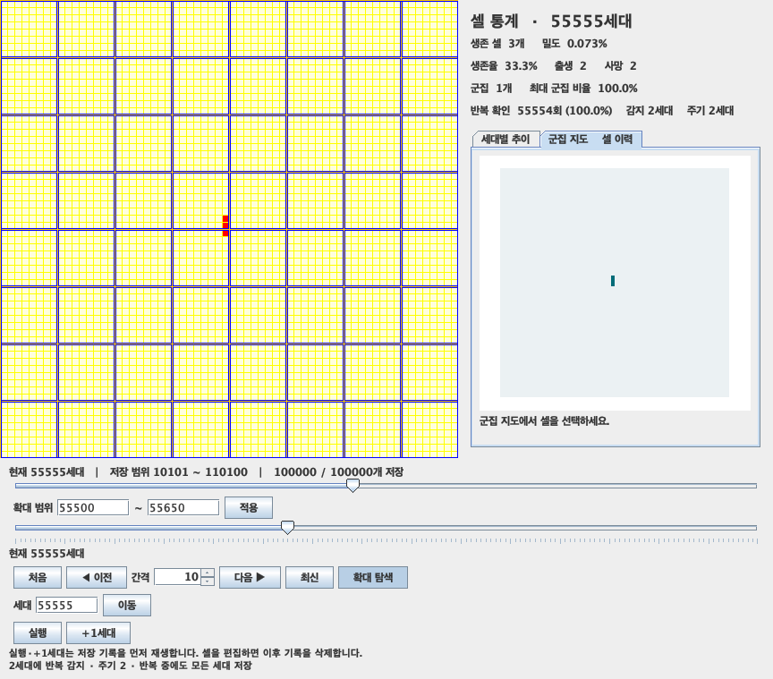

# Life-Game
CAU CSE DP project

## 사용자 패턴 라이브러리

메인 보드에서 셀을 배치한 후 메뉴에서 **Grid > Patterns...**를 누르면 시뮬레이션이 정지되고 패턴 라이브러리 창이 열립니다. 현재 보드의 모양은 임시 항목 **Current**로 표시되며, 저장된 패턴은 이름과 썸네일로 확인할 수 있습니다. 최초 목록에는 Glider, Blinker, Block, Toad가 제공됩니다.

1. **Current**를 선택하고 원하는 이름을 입력한 뒤 **Save**를 눌러 현재 보드의 모양을 저장합니다. 빈 보드는 저장할 수 없고, 저장 후 임시 항목은 목록에서 사라집니다.
2. 저장된 패턴을 선택한 뒤 **Apply**를 누르면 기존 보드가 지워지고 선택한 패턴이 중앙에 배치됩니다. 아직 저장하지 않은 Current에 살아 있는 셀이 있으면 **Back / Apply** 확인 창이 표시됩니다.
3. 저장된 패턴의 이름을 바꾼 후 **Save**를 누르면 해당 항목이 갱신됩니다. **Delete**는 선택한 저장 항목을 확인 후 삭제합니다.
4. 새로운 모양을 만들려면 라이브러리 창을 닫고 메인 보드에서 셀을 편집한 후 다시 Grid > Patterns...를 엽니다. 창을 닫기만 하면 메인 보드는 변경되지 않으며, Save하지 않은 편집은 영구 저장되지 않습니다.

변경사항이 있고 살아 있는 셀이 있는 경우 Save가 활성화됩니다. Apply와 Delete는 저장된 항목에 수정사항이 없을 때 활성화됩니다.

패턴은 사용자 홈의 `.holub-life/patterns.xml`에 저장되어 재실행 후에도 유지됩니다. 기존 Grid 메뉴의 `.life` 보드 파일과 별도 형식입니다. 최대 64×64 모양과 한글 이름을 지원합니다. 빈 이름, 중복 이름, 예약 이름 Current 및 살아 있는 셀이 없는 패턴은 새로 저장할 수 없습니다.

## 실행

Java 8 이상에서 실행할 수 있습니다. 저장소 루트에서 소스를 컴파일한 뒤 실행하세요.

```sh
javac -encoding UTF-8 -d bin -sourcepath src src/com/holub/life/Life.java
java -cp bin com.holub.life.Life
```

Windows에서는 `run.bat`을 실행할 수 있습니다. JAVA_HOME이 있으면 해당 JDK를 사용하고, 없으면 PATH의 javac/java를 사용합니다.

```powershell
$env:JAVA_HOME = 'C:\Program Files\Java\jdk-22'
.\run.bat
```

Eclipse에서는 Java 프로젝트에 src를 소스 폴더로 등록한 뒤 Life.java를 **Run As → Java Application**으로 실행합니다. 테스트도 실행하려면 test를 소스 폴더로 등록하고 JUnit 5 라이브러리를 추가합니다.

## 테스트

JUnit 5 테스트로 기본 프리셋, 세대 변화, 편집 상태, 현재 보드 스냅샷, 파일 저장·불러오기와 실패 시 편집 보존을 검증할 수 있습니다. 이전 편집 창에서 통과한 39개 테스트 기록은 이번 UI 변경 이전의 결과이며, 최신 버전은 다시 실행해야 합니다.

설치된 Eclipse의 JUnit 플러그인 JAR와 JDK 9 이상을 이용한 명령줄 실행:

```powershell
.\tools\test.ps1 -JdkDirectory 'C:\Program Files\Java\jdk-22' -EclipsePlugins 'C:\path\to\eclipse\plugins'
```

이 스크립트는 운영 소스를 Java 8 대상으로 컴파일합니다. 별도 데이터로 GUI를 시험하려면 테스트 스크립트 실행 후 다음 명령을 사용합니다.

```powershell
& "$env:JAVA_HOME\bin\java.exe" '-Dholub.life.patterns.file=build/ui-patterns.xml' -cp build/classes com.holub.life.Life
```

## 설계와 통합

Observer로 모델 변경을 화면에 반영하고, Repository로 파일 저장을 분리합니다. 현재 보드 읽기와 패턴 배치는 기존 Composite/Memento 구조를 활용하며, 배치 요청은 Command로 전달합니다. 썸네일 렌더링은 PatternListCellRenderer에 분리합니다.

### 주요 변경 파일

| 경로 | 역할 |
| --- | --- |
| `src/com/holub/life/patterns/` | 기본 프리셋, 현재 보드 스냅샷, 썸네일 목록, XML 저장 및 배치 명령 (Java 소스 17개) |
| `src/com/holub/life/Universe.java` | 기존 게임 화면의 Grid 메뉴에 Patterns... 항목 연결 |
| `src/com/holub/life/Neighborhood.java` | 패턴 불러오기 후 블록 경계의 활성 상태 전파 보완 |
| `test/com/holub/life/patterns/` | 프리셋, 편집 모델 및 저장소 테스트 3개 클래스 |
| `run.bat`, `tools/` | Windows 실행 및 테스트 도구 |

패턴 패키지만 복사하면 기존 게임 화면에 메뉴가 연결되지 않습니다. 다른 기능과 통합할 때는 `Universe.java`의 메뉴 설치 호출과 `Neighborhood.transfer()`의 경계 상태 보완도 함께 유지하고 전체 테스트를 실행하세요. Conway의 생존·사망 규칙과 기존 Grid/Go 기능은 유지합니다.

초기 구현 및 이전 편집 창의 설계 근거와 UML은 [패턴 라이브러리 구현 문서](docs/pattern-library.md)를 참고하세요. 해당 문서의 직접 격자 편집 및 new.../load UI 설명은 현재 버전과 다릅니다. 현재 버전의 사용법은 이 README를 기준으로 합니다.
# Life Game — Timeline & Statistics

CAU CSE Design Pattern 팀 프로젝트의 **세대 되돌리기와 셀 통계 통합 구현**입니다.
Holub Life Game을 기반으로 `feature/generation-timeline`의 기록·탐색 기능과
`statistics`의 통계·시각화 기능을 하나의 세대 모델에 연결했습니다.

- 저장소: [DesignPattern-26-2/Life-Game](https://github.com/DesignPattern-26-2/Life-Game)
- 통합 브랜치: `feature/timeline-statistics`
- 구현 기준: 통합 커밋 `14db634`에 2026-11-26의 연속 저장·10만 개 한도·사용자 지정 확대 탐색·실행/정지 통합 반영
- 참고 문서: [기존 Timeline README](https://github.com/DesignPattern-26-2/Life-Game/blob/4579b45/README.md), [기존 Statistics README](https://github.com/DesignPattern-26-2/Life-Game/blob/bf42422/README.md)

이 문서는 **현재 통합 코드의 동작**을 설명합니다. 두 원본 브랜치와 달라진 정책은 각 섹션에 명시했습니다.
기능 설명은 **Timeline → Statistics** 순서이며, 실행 방법·코드 구조·JUnit·성능 자료는 뒤쪽 공통 섹션에 모았습니다.

## 1. Timeline — 세대 기록과 탐색

### 1.1 기능과 조작

| 기능 | 동작 |
|---|---|
| 전체 타임라인 슬라이더 | 저장된 세대로 이동. 드래그 중 실행을 정지하고 놓을 때 보드 복원 |
| 세대 번호 + 이동 / Enter | 저장 범위 안의 특정 세대로 이동 |
| 간격 + 이전 / 다음 | 1~1,000 사이 정수 간격으로 이동. 저장 범위를 넘으면 경계에서 멈춤 |
| 처음 / 최신 | 가장 오래된 / 가장 최근의 저장 세대로 이동 |
| 확대 탐색 | 전체 슬라이더 아래에 사용자 지정 구간의 상세 슬라이더 표시 |
| 실행/정지 통합 버튼 | 정지 중에는 `실행`, 실행 중에는 `정지`로 표시 |
| +1세대 | 다음 저장 기록을 재생하고, 저장 끝에서는 새 세대를 계산 |
| 상태 표시 | 현재 세대, 저장 범위, 저장 개수와 한도, 반복·안정 상태 |

실행 버튼의 기본 간격은 150ms이며 원본 `Go` 메뉴의 속도 선택도 유지합니다.
통합 버튼은 메뉴를 통한 시작·정지, 탐색, 셀 편집에 따른 정지, 안정 상태 자동 정지와 동기화됩니다.
`처음`은 항상 0세대를 뜻하지 않습니다. 오래된 기록이 만료되면 남아 있는 가장 오래된 세대로 이동합니다.

### 1.2 사용자 지정 확대 탐색

1. `확대 탐색`을 누릅니다. 처음에는 현재 세대 주변 최대 100세대 폭을 제안합니다.
2. `확대 범위 [시작 세대] ~ [끝 세대]`를 입력합니다.
3. `적용` 또는 Enter를 누른 뒤 상세 슬라이더·방향키로 세밀하게 이동합니다.

예를 들어 전체 기록이 `0~50000`일 때 확대 범위를 `1200~1250`으로 지정할 수 있습니다.
범위를 적용하는 것만으로 현재 보드가 이동하거나 편집되지는 않습니다.

- 시작·끝은 저장 범위 안의 정수이며 **시작 ≤ 끝**이어야 합니다.
- 잘못된 입력은 거부하며 기존 적용 범위와 기록을 유지합니다.
- 지정한 범위는 다른 세대를 조회하거나 접었다 다시 열어도 유지됩니다.
- 현재 세대가 확대 범위 밖이면 `확대 범위 밖`으로 표시합니다.
- 기록 만료나 과거 편집으로 지정 구간이 사라지면 남은 저장 범위에 맞춰 조정합니다.
- 입력 중에는 상태 갱신이 작성 중인 문자열을 덮어쓰지 않습니다.
- 한 세대만 지정하면 슬라이더를 비활성화하고, 200세대보다 넓은 구간에서는 과도한 눈금을 생략합니다.

이전 확대 탐색의 `◀ 구간`, `현재 중심`, `구간 ▶` 버튼은 제거했습니다.



이미지는 실제 Swing 구성요소를 창 없이 렌더링한 미리보기입니다.

### 1.3 연속 저장과 10만 개 한도

초기 보드를 0세대로 저장하고 **최근 100,000개의 연속된 세대 기록**을 메모리에 보관합니다.
한도를 넘으면 가장 오래된 기록부터 만료하지만 실제 세대 번호는 유지합니다.
사용자가 저장 한도를 설정하는 UI는 제공하지 않습니다.

```text
99999세대까지 진행 → 0~99999 보관 (100000개)
새 100000세대 계산 → 1~100000 보관
100005세대까지 진행 → 6~100005 보관
```

저장소는 순환 버퍼를 사용합니다. 저장 끝에서 추가, 오래된 기록 만료, 세대 조회는 O(1)입니다.
과거 편집 시에는 삭제할 미래 기록의 참조를 해제하므로 폐기하는 개수에 비례한 작업이 발생합니다.

### 1.4 과거 편집과 기록 재생

**탐색만으로 미래 기록을 삭제하지 않습니다.** 셀을 편집할 때 해당 세대를 교체하고 이후 보드·통계 기록을 함께 삭제합니다.

```text
기존 기록:              0 … 9 → 10 → 11 … 20
10세대 편집:           0 … 9 → 수정된 10       (기존 11~20 삭제)
이후 실행:             0 … 9 → 수정된 10 → 새 11 … 25
9세대 복귀 후 +1세대:  수정된 10과 통계 복원
계속 진행:             저장된 11~25 재생 → 끝에서 새 26 계산
```

`실행`과 `+1세대`는 같은 재생 정책을 따르며, 저장된 편집 결과를 재계산으로 덮어쓰지 않습니다.
반복 중에도 매 세대를 기록하므로 저장 공백 뒤에서 편집할 때 과거 기록이 전부 사라지던 상황이 없어졌습니다.

예를 들어 `6~100005`를 보관한 상태에서 100005세대를 편집하면 **6~100004는 유지하고 100005만 교체**합니다.
이후 새 100006세대를 계산하면 저장 범위는 `7~100006`이 됩니다.

### 1.5 반복 감지와 안정 상태

보드 전체의 셀 상태가 **좌표까지 정확히 일치**하면 반복으로 판정합니다.
셀 개수나 일부 패턴만 같다는 이유로 판정하지 않으며, 이동 중인 Glider도 모양만 같으면 반복으로 보지 않습니다.

- Blinker는 2세대에서 반복을 감지하지만 3, 4, 5…세대도 **계속 저장**합니다.
- 반복 판정은 정보 제공 목적이며 저장을 중단시키지 않습니다.
- 탐색·재생은 기존 판정을 유지하고, 편집·새 게임은 판정을 초기화합니다.
- 편집 이전 기록은 새 분기의 반복 판정에서 제외합니다.
- 정확한 비교는 최근 최대 1,000개에 한정하고, 더 긴 주기는 Brent 방식으로 보완합니다.
- 긴 주기는 첫 재등장보다 늦게 감지될 수 있습니다. **감지 세대와 실제 반복 구간의 시작은 다릅니다.**

다음 상태에 셀 변화가 전혀 없으면 세대 번호를 늘리거나 중복 저장하지 않고 자동 정지합니다.
처음부터 고정 블록·빈 보드는 0세대, 단독 셀이 1세대에 소멸하면 1세대에서 멈춥니다.
안정 상태에서 `+1세대`를 눌러도 번호가 증가하지 않으며 편집 후에는 다시 진행할 수 있습니다.

반복 분석의 담당 모듈 이동과 슬라이더 색상 표시는 **검토 중이며 구현하지 않았습니다.**
현재는 `LifeHistory`와 `CycleDetector`의 결과를 타임라인 문구와 통계가 사용합니다.

### 1.6 기존 Timeline 브랜치 대비 변경

| 항목 | 기존 원격 Timeline | 현재 통합 코드 |
|---|---|---|
| 기본 저장 한도 | 1,000개 | 100,000개 |
| 반복 감지 이후 | 보드 저장 중단 | 모든 변화 세대 연속 저장 |
| 반복 후 편집 | 저장 공백 뒤 편집 시 새 구간 시작 | 보관 중인 이전 기록 유지 |
| 저장 자료구조 | ArrayList의 맨 앞 삭제 | 순환 버퍼 |
| 세부 탐색 | 전체 슬라이더·번호·간격 이동 | 사용자 지정 확대 슬라이더 추가 |
| 실행 제어 | 실행·정지 버튼 분리 | 실제 실행 상태를 반영하는 통합 버튼 |
| 세대별 데이터 | 보드 스냅샷 | 보드 스냅샷 + 해당 세대 통계 |

`Clear`와 성공한 `Load`는 새 0세대부터 시작합니다. `Store`는 현재 보드만 기존 `.life` 형식으로 저장합니다.
앱 종료 후 히스토리 복구와 여러 분기 동시 보관은 지원하지 않습니다.

## 2. Statistics — 셀 통계와 시각화

오른쪽 통계 패널은 **현재 게임판에 표시된 세대**의 상태를 보여줍니다.
별도 통계 슬라이더나 독립적인 세대 진행 엔진 없이 Timeline과 동일한 `LifeHistory`를 사용합니다.

### 2.1 지표의 의미

| 지표 | 현재 코드의 계산·표시 기준 |
|---|---|
| 생존 셀 수 | 현재 보드에서 살아 있는 셀 개수 |
| 생존율 | 직전 세대의 생존 셀 중 같은 좌표에서 살아남은 비율: 생존 유지 수 / 직전 생존 셀 수 |
| 출생 | 직전 세대에는 죽어 있었지만 현재 살아 있는 셀 수 |
| 사망 | 직전 세대에는 살아 있었지만 현재 죽은 셀 수 |
| 개체 밀도 | 생존 셀 수 / 보드 전체 칸 수 |
| 군집 수 | 상하좌우·대각선의 8방향으로 연결된 생존 셀 집합 수 |
| 최대 군집 비율 | 가장 큰 군집의 셀 수 / 전체 생존 셀 수 |
| 반복 확인 비율 | 현재 기준 배치 이후 진행한 세대 중 반복 감지 시점부터 현재까지의 세대가 차지하는 비율 |
| 감지·주기 | 반복을 감지한 세대와 확인된 주기 길이 |

군집은 보드 가장자리를 넘어 반대쪽과 연결하지 않습니다.
분모가 0인 지표는 계산할 수 없으므로 `—`로 표시합니다.
초기 배치·편집 직후에는 `기준 배치`를 표시하고 생존율도 `—`로 표시합니다.

**반복 확인 비율은 기존 Statistics의 ‘재등장 빈도’와 구분됩니다.**
현재 기준 세대가 `b`, 조회 세대가 `t`, 감지 세대가 `d`라면 감지 이후 비율은 `(t - d + 1) / (t - b)`입니다.
감지 전에는 분모가 양수일 때 0이며 기준 세대에서는 `—`입니다.
긴 주기를 늦게 감지한 경우 실제로 재등장했던 모든 세대를 소급해서 세는 지표는 아닙니다.

예를 들어 초기 Blinker를 4세대까지 진행하면 2세대부터 반복이 확인되어 비율은 `3/4 = 75%`입니다.
Blinker의 한 세대 전환에서는 기존 3개 중 중앙 셀 1개가 살아남고 2개가 죽으며 새 셀 2개가 태어나므로,
생존율은 `1/3 ≈ 33.3%`, 출생과 사망은 각각 2개입니다. 반복 확인 비율과 생존율은 서로 다른 지표입니다.

### 2.2 세대별 추이

`세대별 추이` 탭의 선택 상자에서 **생존율·개체 밀도·최대 군집 비율·반복 확인 비율**을 선택합니다.
그래프는 조회 세대까지 최근 최대 **120세대**를 표시합니다.
보관된 기록의 시작이나 편집으로 설정한 기준 세대를 넘어서 과거로 확장하지 않습니다.
타임라인에서 세대를 옮기면 통계 수치와 그래프도 함께 갱신됩니다.

### 2.3 군집 지도와 셀 이력

`군집 지도 · 셀 이력` 탭은 생존 셀을 군집별 색으로 표시합니다.
지도에서 칸을 클릭하면 선택 좌표의 현재 생사와 최근 최대 **64세대** 이력을 볼 수 있습니다.
이력은 왼쪽부터 시간순이며 초록 계열은 생존, 회색은 사망을 뜻합니다.
이 역시 저장 시작 및 현재 통계 기준 세대 안에서 표시합니다.



### 2.4 편집·재생·초기화와 통계

| 동작 | 통계 처리 |
|---|---|
| 과거 조회 / 저장 기록 재생 | 해당 세대의 저장된 통계를 표시. 새 진행으로 중복 집계하지 않음 |
| 과거 셀 편집 | 해당 세대의 통계를 새 기준 배치로 교체하고 이후 통계 삭제. 이전 기록은 유지 |
| 편집 후 새 세대 계산 | 편집한 보드를 기준으로 자연 출생·사망·생존율 계산 |
| 반복 중 계속 진행 | 세대별 통계 계속 저장. 보드 스냅샷은 불변 상태를 공유할 수 있음 |
| 안정 상태 | 세대 번호와 기록을 추가하지 않고 현재 통계 유지 |
| 오래된 기록 만료 | 보드와 대응 통계를 함께 만료. 조회 가능한 범위도 일치 |
| Clear / 성공한 Load | 새 0세대 및 새 통계 기준 배치 생성 |

### 2.5 기존 Statistics 브랜치 대비 변경

기존 README의 통계 지표와 시각화 설명을 유지하되, 세대 진행·조회·편집 정책은 통합 모델에 맞췄습니다.

| 항목 | 기존 Statistics README의 동작 | 현재 통합 코드 |
|---|---|---|
| 변화 없는 보드 | 매 틱 세대와 통계 기록 추가 | 안정 상태로 정지하고 같은 세대 유지 |
| 셀 편집 | 전체 실험을 새 0세대로 초기화 | 현재 번호에서 새 통계 기준 배치 생성, 이전 기록 보존·이후 기록 삭제 |
| 과거 조회 | 통계 전용 슬라이더와 최신 세대 버튼 | Timeline 탐색에 보드·통계가 함께 동기화 |
| 반복 관련 지표 | 과거 전체 배치의 재등장 빈도 | 반복이 확인된 시점 이후의 세대 비율 |
| 기록 보관 | 독립적인 통계 이력 | 보드와 통계를 묶은 최근 100,000개 기록 |
| 그래프·셀 이력 | 최근 120세대·64세대 표시 | 표시 길이는 유지하고, 보관 범위와 편집 기준 세대 안으로 제한 |

따라서 기존 Statistics README의 실행·테스트 명령이나 초기화 설명을 그대로 적용하지 말고,
아래 공통 실행 방법과 JUnit 안내를 사용하세요.

## 3. 공통 실행 방법

**JDK 17 이상**이 필요합니다. `java -version`과 `javac -version`으로 확인하세요.

처음 내려받는 경우:

```bash
git clone --branch feature/timeline-statistics https://github.com/DesignPattern-26-2/Life-Game.git
cd Life-Game
```

프로젝트 최상위 폴더에서 실행합니다.

```bash
sh run.command
```

소스를 빌드한 뒤 실행합니다. 현재 코드의 창 제목은 **`2026-11-26 · 통계 통합·10만 세대`**입니다.
이전 창이 열려 있다면 종료한 뒤 다시 실행하세요.

빌드·실행을 나누려면:

```bash
sh build.sh
java -jar build/Life-Game-timeline.jar
```

- Windows: `run.bat` 실행.
- IntelliJ IDEA: `pom.xml`을 프로젝트로 열고 JDK 17 이상을 지정한 뒤 `com.holub.life.Life.main()` 실행.
- 검증 환경: macOS / JDK 26.0.2.1, Java 17 대상으로 컴파일. Windows 및 Maven 실행 경로는 별도 미검증.
- `build/`는 Git 제외 대상이며 빌드 시 생성됩니다. 루트 `com/`의 기존 바이너리 대신 새 실행 파일을 사용하세요.

`Grid > Load`에서 예제를 불러올 수 있습니다.

| 예제 | 확인할 내용 |
|---|---|
| [blinker.life](examples/blinker.life) | 주기 2 감지, 반복 중 연속 저장, 생존율·출생·사망 |
| [boundary-blinker.life](examples/boundary-blinker.life) | 내부 격자 경계를 통과하는 패턴의 계산·복원 |
| [glider.life](examples/glider.life) | 좌표가 달라지는 이동 패턴과 반복 오인 방지 |

## 4. 공통 구조와 기능 연결

주요 구현은 `src/com/holub/life/`, 테스트는 `tests/com/holub/life/`에 있습니다.

| 클래스 | 책임 |
|---|---|
| `GenerationHistory<T>` | 순환 버퍼, 보관 한도, 조회, 미래 기록 폐기 |
| `BoardSnapshot` | 원본 `Cell.Memento` 인터페이스 기반의 불변 보드 상태 |
| `LifeHistory` | 계산·재생·복원·편집, 통계 기록과 반복 판정 연결 |
| `CycleDetector` | 긴 주기 분석 |
| `TimelinePanel`, `DetailTimelinePanel` | 전체·확대 탐색, 입력 검증, 통합 실행 제어 |
| `GenerationStatistics` | 한 세대의 보드 스냅샷과 통계 수치 |
| `ClusterMap` | 8방향 연결 군집 분석 |
| `GenerationMetric` | 수치 및 그래프에 사용하는 지표 계산 |
| `StatisticsPanel` | 통계 수치·추이·군집 지도·셀 이력 표시 |
| `Clock` | Swing 타이머 및 실행 상태 알림 |
| `Universe`, `Life` | 보드 조작·파일 메뉴와 모델 연결, 화면 구성 |
| `Neighborhood` | 복원 후 계산 캐시 갱신 및 격자 경계 계산 |

상태 보존·복원에는 Memento를 활용하고, 모델 변경 및 실행 상태 알림으로 두 화면을 갱신합니다.
다른 팀 기능을 연결할 때는 다음 규칙을 유지합니다.

- 보드 편집: 실행 정지 → 보드 변경 → `LifeHistory.boardEdited()`.
- 새 게임: 보드 변경 후 `LifeHistory.reset()`.
- 다음 진행: `LifeHistory.advance()` 사용. 보드 계산만 직접 호출하면 기록·통계와 어긋날 수 있습니다.
- 상태 변경과 화면 갱신: Swing 이벤트 스레드(EDT)에서 순서대로 처리.
- 규칙·보드 크기·경계 조건 변경: 새 히스토리를 시작하고 스냅샷과 반복 판정의 상태 범위를 재검토.

## 5. JUnit 테스트

JUnit은 기대값과 실제 결과를 자동으로 비교합니다.
검사는 Timeline과 Statistics의 단위·연동 동작 및 관련 원본 Life 규칙의 회귀 검사를 포함하며,
원본 프로그램의 모든 기능에 대한 완전한 검증이나 코드 커버리지 수치를 뜻하지 않습니다.

### 검증 결과와 범위

- **통합 코드 수정 전:** 기존 Timeline 검사 153개가 변경 없이 포함되어 있음을 확인하고, 통계 검사 6개와 함께 **159개 통과**.
- **2026-11-26 현재 코드:** **193개 성공 / 실패 0 / 건너뜀 0**. 빌드된 실행 JAR을 대상으로도 동일하게 통과.
- 반복 후 저장 중단을 기대하던 검사는 새 연속 저장 요구에 맞춰 갱신했습니다.

| 검사 묶음 | 사례 수 | 주요 내용 |
|---|---:|---|
| 기존 Timeline 검사 | 153 | 탐색·편집·재생·안정/반복 판정·입력·타이머·원본 규칙 |
| Statistics 연동 검사 | 6 | 지표, 기준 배치, 조회 동기화, 그래프, 군집 지도·셀 이력 |
| 저장 한도 이후 편집 검사 | 8 | 999/1000/1005 경계와 실제 보드의 기록 보존 |
| 연속 저장·대용량·확대·실행 제어 검사 | 10 | 순환 버퍼 대조, 10만/100만 시험 용량, 반복 후 편집, Clock 동기화 |
| 사용자 지정 범위·통계 보존 검사 | 16 | 잘못된 입력 12종, 범위 유지/조정, 입력 중 갱신, 기본 10만 개 연동 |
| **전체** | **193** | |

대표 검증은 다음과 같습니다.

- 10세대 편집 → 새 25세대까지 진행 → 9세대 복귀 → 편집된 10~25 재생과 새 26 계산.
- 기본 용량 10만 개를 채운 뒤에도 보드와 통계의 세대 번호·만료 범위·편집 결과 일치.
- 무작위 조작 9,600회와 별도 Conway 계산기를 통한 비교.
- 사용자 범위 적용이 보드를 이동하지 않으며, 만료·편집 시 유효한 범위로 조정.
- 실제 Swing 타이머의 실행·정지·안정 상태 정지와 통합 버튼 문구 동기화.

긴 주기 및 대용량 검사의 일부는 알고리즘 검사용 합성 보드를 사용합니다.

### 실행 방법

JUnit Jupiter **5.11.4**, Platform Console Standalone **1.11.4**를 사용합니다.
`lib/*.jar`는 Git에 포함되지 않으므로 처음 내려받은 경우 실행기를 준비하세요.
게임 실행만 할 때는 JUnit이 필요하지 않습니다.

```bash
mkdir -p lib
curl -fL "https://repo.maven.apache.org/maven2/org/junit/platform/junit-platform-console-standalone/1.11.4/junit-platform-console-standalone-1.11.4.jar" -o lib/junit-platform-console-standalone-1.11.4.jar
sh test.sh
```

실행기가 있으면 `sh test.sh`만 실행합니다. Windows용 스크립트는 `test.bat`입니다.
스크립트는 프로그램 빌드 → 테스트 컴파일 → JUnit 실행 → XML 결과 저장을 수행합니다.
결과는 터미널과 `build/test-results/`에서 확인할 수 있습니다.

검사는 창 없는 headless 환경입니다. 실제 OS 창의 메뉴·마우스·파일 선택기 전체,
Windows/Maven 실행, 나머지 팀 기능 통합 후의 동작은 별도로 확인해야 합니다.

## 6. 메모리와 성능

통계까지 포함한 비반복 64×64 세대의 실측 보관 비용은 약 **636바이트/세대**입니다.
스냅샷 576바이트, 통계 객체 56바이트, 저장 배열 참조 4바이트를 합산한 현재 JVM 기준입니다.
10만 개의 기록 데이터는 약 **60.65MiB**, 128MiB 힙 제한의 합성 모델에서 GC 후 총 힙은 약 **63.24MiB**였습니다.

반복 상태는 봉인된 스냅샷을 공유할 수 있지만, 세대 번호와 통계는 각각 보관합니다.
용량 예산은 공유가 없는 비반복 사례를 기준으로 계산했습니다.

실제 64×64 Blinker에서 10만 개를 보관한 채 계산·통계·두 UI 값 갱신 10,000회의 p95는 **0.0935ms**였습니다.
합성 비반복 검사에서는 GC를 포함한 최대 약 **29.56ms**가 관찰됐습니다.
이는 현재 Mac의 headless 측정이며 4GB 구형 노트북의 무발열·무지연을 보장하지 않습니다.
정량 예산과 조건은 [통합 검토 보고서](docs/INTEGRATION-REVIEW.txt)에 정리했습니다.

성능 측정은 JUnit과 별도로 실행합니다.

```bash
sh benchmarks/run.sh
```

## 7. 참고 자료

- [기능 보존 사전 검토·요청 반영·메모리 분석](docs/INTEGRATION-REVIEW.txt)
- [수정 전 159개 검사 로그](docs/integration-baseline-tests.txt)
- [현재 193개 검사 로그](docs/integrated-test-results.txt)
- [통계 포함 성능 측정](docs/integrated-performance.txt)
- [JUnit 의존성 안내](docs/DEPENDENCIES.txt)

`docs/AUDIT-REPORT.txt`, `docs/DELIVERY-VERIFICATION.txt`, `docs/test-results.txt`는 이전 11월 22일 버전의 기록입니다.
현재 동작은 이 README와 통합 검토 보고서를 기준으로 확인하세요.
원본 Holub 저작자 표시는 유지하며 저장소 라이선스는 [LICENSE](LICENSE)를 참고하세요.
