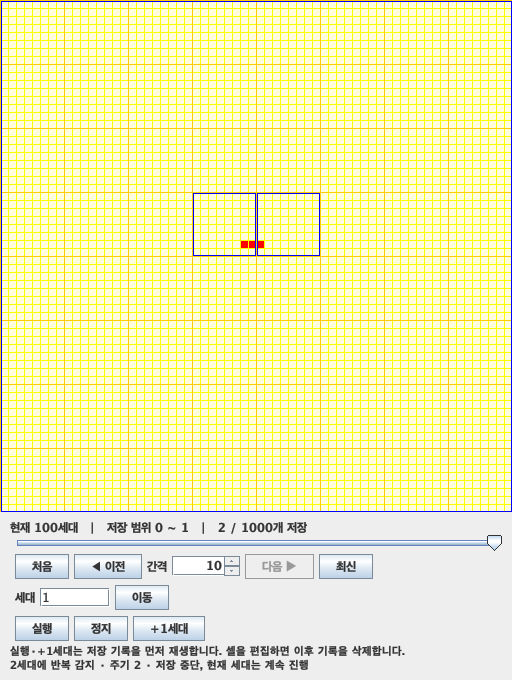

# Life Game — Generation Timeline

CAU CSE Design Pattern 팀 프로젝트의 **세대 되돌리기 기능 구현 브랜치**입니다.
Holub Life Game에 세대별 보드 저장, 타임라인 탐색, 과거 편집 후 새로운 기록 생성,
반복 패턴 감지 및 저장 한도 관리를 추가했습니다.

- 저장소: [DesignPattern-26-2/Life-Game](https://github.com/DesignPattern-26-2/Life-Game)
- 기능 브랜치: `feature/generation-timeline`
- 범위: 세대 타임라인 기능과 관련 원본 코드 수정. 팀의 나머지 기능 통합 및 전체 설계 개선은 별도 단계입니다.

## 1. 실행 방법

**JDK 17 이상**이 필요합니다. `java -version`과 `javac -version`으로 설치를 확인하세요.
검증 환경은 macOS / JDK 26.0.2.1이며, Java 17을 대상으로 컴파일했습니다.

### 처음 내려받는 경우

```bash
git clone --branch feature/generation-timeline https://github.com/DesignPattern-26-2/Life-Game.git
cd Life-Game
```

### macOS 실행

프로젝트 최상위 폴더에서 실행합니다.

```bash
sh run.command
```

소스를 자동으로 빌드한 뒤 게임을 실행합니다. 기존 게임 창이 열려 있다면 닫고 다시 실행하세요.
현재 검증판의 창 제목에는 `[2026-11-22 · 종합 검증판]`이 표시됩니다.

빌드와 실행을 나누려면 다음 명령을 사용합니다.

```bash
sh build.sh
java -jar build/Life-Game-timeline.jar
```

### 다른 실행 환경

- Windows: 프로젝트 폴더에서 `run.bat` 실행.
- IntelliJ IDEA: `pom.xml`을 프로젝트로 열고 JDK 17 이상을 지정한 뒤 `com.holub.life.Life.main()` 실행.
- Windows 및 Maven을 통한 빌드·테스트는 별도 검증하지 않았습니다.

`build/`는 Git에 포함되지 않으며 빌드 시 생성됩니다. 저장소 루트의 기존 `com/` 바이너리 대신 위 스크립트로 생성한 실행 파일을 사용하세요.

## 2. 주요 기능과 조작

| 기능 | 동작 |
|---|---|
| 타임라인 슬라이더 | 저장된 세대로 이동. 드래그 중 자동 실행을 정지하고 놓을 때 보드를 복원 |
| 세대 번호 + 이동 / Enter | 저장 범위 안의 특정 세대로 이동 |
| 간격 + 이전 / 다음 | 1~1,000 사이 정수 간격으로 이동. 저장 범위를 넘으면 경계에서 멈춤 |
| 처음 / 최신 | 현재 저장된 가장 오래된 / 가장 최근 세대로 이동 |
| 실행 / 정지 | 자동 진행 시작 / 중단. 실행 버튼의 기본 간격은 150ms |
| +1세대 | 다음 저장 기록이 있으면 복원하고, 저장 끝에서는 새 세대를 계산 |
| 상태 표시 | 현재 세대, 저장 범위, 저장 개수 및 반복·안정 상태 표시 |

원본 `Go` 메뉴의 속도 선택도 유지합니다.
`처음`은 항상 0세대를 뜻하지 않으며, `최신`은 저장 범위를 벗어나 진행한 현재 세대가 아니라 **마지막 저장 세대**를 뜻합니다.

## 3. 히스토리 동작 정책

### 저장 한도: 1,000개

- 초기 보드를 0세대로 저장하고, 최대 **1,000개의 연속된 보드 상태**를 메모리에 보관합니다.
- 한도를 넘으면 가장 오래된 상태부터 삭제하고 실제 세대 번호는 유지합니다.
- 예: 0~999를 보관한 뒤 새 1000세대를 저장하면 범위는 1~1000이 됩니다.
- 사용자 저장 한도 설정 UI는 제공하지 않습니다.

### 과거 편집과 기록 재생

과거로 이동하는 것만으로는 미래 기록을 삭제하지 않습니다. **해당 세대에서 셀을 편집할 때** 그 세대를 교체하고 이후 기록을 삭제합니다.

```text
기존 기록:                 0 … 9 → 10 → 11 … 20
10세대에서 셀 편집:        0 … 9 → 수정된 10      (기존 11~20 삭제)
이후 실행:                0 … 9 → 수정된 10 → 새 11 … 25
9세대로 돌아가 +1세대:     수정된 10을 그대로 복원
계속 진행:                저장된 11~25 재생 → 끝에서 새 26 계산
```

`실행`과 `+1세대` 모두 같은 원칙을 따릅니다. 저장된 편집 결과를 재계산으로 덮어쓰지 않습니다.
새 분기의 반복 여부를 판정할 때는 편집 이전 기록을 비교 대상에서 제외합니다.

### 반복 패턴 감지

보드 전체의 셀 상태가 좌표까지 정확히 일치하면 반복으로 판정합니다.
살아 있는 셀 개수나 일부 패턴만 같다는 이유로 반복으로 판단하지 않습니다.

- Blinker: 2세대에서 0세대와 같은 상태를 감지하면 **0~1세대만 저장**합니다.
- 이후 보드는 계속 변화하고 현재 세대 번호도 증가하지만 저장 범위와 개수는 고정됩니다.
- 이동 중인 Glider는 모양이 같아도 좌표가 다르므로 반복으로 오인하지 않습니다.
- 탐색·재생은 기존 반복 판정을 유지하고, 편집·초기화는 판정을 초기화합니다.

최근 저장 기록과의 정확한 비교에 더해 Brent 방식의 감지기로 긴 주기를 검사합니다.
저장 한도보다 긴 주기는 첫 재등장보다 늦게 감지될 수 있으며, **실제로 감지한 세대의 직전까지 남아 있는 기록**을 보관합니다.

### 셀 변화가 없는 상태

다음 보드가 현재 보드와 같으면 세대 번호를 늘리거나 중복 저장하지 않고 자동 정지합니다.

- 처음부터 고정 블록 또는 빈 보드: 0세대에서 정지.
- 단독 셀이 1세대에 소멸한 경우: 1세대에서 정지.
- 안정 상태에서 `+1세대`를 눌러도 번호가 증가하지 않으며, 편집 후에는 다시 진행할 수 있습니다.

### 현재 세대와 저장 범위가 다른 경우

반복 감지 후 현재 번호가 저장 끝을 넘으면 상단에는 **실제 현재 세대**, 이동 입력칸에는 **마지막 저장 세대**를 표시합니다.
예를 들어 현재 1007세대 / 저장 0~159라면 이동 입력칸에는 `159`가 표시됩니다.

저장되지 않은 현재 세대에서 편집하면 그 번호부터 새 기록 구간을 시작합니다.
예: 현재 100 / 저장 0~1에서 편집 → 저장 범위 100~100.
기존 과거 기록을 유지하며 편집하려면 먼저 저장된 세대로 이동하세요.

`Clear`와 성공한 `Load`는 새 0세대부터 시작합니다. `Store`는 현재 보드만 원본 `.life` 형식으로 저장합니다.
앱 종료 후 히스토리 복구 및 여러 분기 동시 보관은 지원하지 않습니다.

## 4. 예제와 화면

`Grid > Load`에서 다음 예제를 불러올 수 있습니다.

- [blinker.life](examples/blinker.life): 주기 2 반복과 저장 중단 확인.
- [boundary-blinker.life](examples/boundary-blinker.life): 내부 격자 경계에 걸친 패턴 확인.
- [glider.life](examples/glider.life): 이동하는 패턴의 세대 변화 확인.

아래 이미지는 실제 Swing 구성요소를 창 없이 렌더링한 미리보기입니다. 현재 100세대와 저장 범위 0~1의 구분을 보여줍니다.



## 5. 코드 구조와 통합 지점

주요 코드는 `src/com/holub/life/`, 테스트는 `tests/com/holub/life/`에 있습니다.

| 클래스 | 역할 |
|---|---|
| `GenerationHistory` | 고정 용량 기록, 탐색, 편집 시 미래 삭제, 절대 세대 번호 관리 |
| `BoardSnapshot` | `BitSet` 기반 불변 보드 상태. 원본 `Cell.Memento` 인터페이스 활용 |
| `CycleDetector` | 긴 주기를 검사하는 Brent 방식 반복 감지 |
| `LifeHistory` | 세대 계산·기록 재생·복원·편집·반복 판정 연결 |
| `TimelinePanel` | 타임라인, 번호·간격 입력, 실행 제어, 상태 표시 |
| `Universe` | 셀 클릭 및 Clear/Load와 히스토리 연결 |
| `Clock`, `Life` | Swing 이벤트 스레드에서 타이머 및 UI 처리 |
| `Neighborhood` | 상태 복원 후 계산 캐시를 갱신하여 경계 셀 계산 누락 방지 |

팀 기능을 통합할 때는 다음 연결을 유지해야 합니다.

- 패턴 삽입·랜덤 생성 등 보드를 편집하는 기능: 실행을 정지하고 보드 변경 후 `LifeHistory.boardEdited()` 호출.
- 새 보드 시작: 보드 변경 후 `LifeHistory.reset()` 호출.
- 다음 세대 진행: `LifeHistory.advance()` 사용. 원본 계산만 직접 호출하면 기록과 화면이 어긋날 수 있습니다.
- 상태 변경과 UI 갱신: Swing 이벤트 스레드(EDT)에서 순서대로 처리.
- 보드 크기·규칙·경계 조건 변경: 새 히스토리를 시작하고 스냅샷 및 반복 판정에 필요한 상태 범위를 재검토.

## 6. JUnit 테스트

JUnit은 Java 코드의 실제 결과와 기대값을 자동으로 비교하는 테스트 프레임워크입니다.
이 브랜치는 **추가한 타임라인 기능의 단위·연동 검사와 관련 원본 동작의 회귀 검사**를 포함합니다.
원본 세대 계산 코드도 함께 실행하지만, 원본 프로그램의 모든 기능을 빠짐없이 검증한 것은 아닙니다.

### 실행 방법

JUnit Jupiter **5.11.4**, JUnit Platform Console Standalone **1.11.4**를 사용합니다.
`lib/*.jar`는 Git에 포함되지 않으므로, 처음 clone한 경우 프로젝트 폴더에서 실행기를 먼저 받으세요.
게임 실행만 할 때는 JUnit이 필요하지 않습니다.

```bash
mkdir -p lib
curl -fL "https://repo.maven.apache.org/maven2/org/junit/platform/junit-platform-console-standalone/1.11.4/junit-platform-console-standalone-1.11.4.jar" -o lib/junit-platform-console-standalone-1.11.4.jar
sh test.sh
```

이미 실행기가 있으면 `sh test.sh`만 실행하면 됩니다.
Windows에서는 같은 JAR을 `lib/`에 넣은 뒤 `test.bat`를 실행합니다.

`test.sh`는 프로그램 빌드 → 테스트 코드 컴파일 → JUnit 테스트 탐색·실행 → 결과 저장을 수행합니다.
창을 띄우지 않는 headless 모드에서 보드 상태, Swing 버튼·슬라이더, 실제 Swing 타이머 동작을 검사합니다.
새 실행 결과는 터미널과 `build/test-results/`의 XML 파일에서 확인할 수 있습니다.

### 테스트 구성과 기존 결과

**2026-11-22 종합 검증판: 153개 실행 / 153개 성공 / 실패 0 / 건너뜀 0.**
매개변수별 실행을 포함한 사례 수이며, 테스트 파일 개수나 코드 커버리지 비율을 뜻하지 않습니다.

| 테스트 클래스 | 사례 수 | 주요 검사 |
|---|---:|---|
| `GenerationHistoryTest` | 9 | 저장, 탐색, 편집 분기, 한도 초과 및 번호 유지 |
| `LifeHistoryTest` | 27 | 반복·안정 판정, 편집 후 재생, 보드 복원, 스냅샷 보존 |
| `CycleDetectorTest` | 4 | 다양한 주기, 긴 주기, 해시가 같은 다른 상태 구별 |
| `TimelinePanelTest` | 8 | 버튼·슬라이더·입력·상태 표시와 히스토리 연결 |
| `ReplayCycleAuditTest` | 2 | 반복 범위 보존과 안정 상태 재생 |
| `RandomWorkflowAuditTest` | 24 | 고정 시드별 400조작, 총 9,600회 기준 모델 대조 |
| `RetentionAndPatternAuditTest` | 47 | 패턴 경계·회전, 저장 한도, 긴 주기, 파일 형식 |
| `InputAndTimerAuditTest` | 32 | 입력 검증, 실제 타이머 실행·정지·재시작, 슬라이더 갱신 |
| **합계** | **153** | |

`AuditSupport.java`는 공통 테스트 도구입니다. 보드 계산은 별도의 단순 Conway 계산기와 대조합니다.
긴 주기 및 20,000세대 저장 한도 검사의 일부는 알고리즘 검사용 합성 보드를 사용합니다.

특히 **10세대 편집 → 새 25세대까지 진행 → 9세대로 복귀 → +1세대/자동 실행**에서
편집한 셀과 이후 기록이 보존되고, 저장 끝에서 새 26세대가 생성되는지 검사했습니다.
배포 후보 ZIP의 실행 JAR도 별도로 추출하여 재빌드 없이 동일한 153개 검사를 통과했습니다.

검사를 통해 편집 기록 유실, 반복 기록 재생 시 저장 범위 증가, 안정 상태 복원 누락,
`1.5`·`10abc`·`1e2` 같은 잘못된 간격 입력 수용 문제 등을 재현하고 수정했습니다.

### 검증 범위의 한계

- 실제 macOS 창의 마우스·메뉴·파일 선택기 조작은 이 자동 검사에 포함되지 않습니다.
- Windows 실행, 다른 JDK 및 Maven 경로는 별도 검증하지 않았습니다.
- 다른 팀원 기능과 통합한 후 전체 회귀 검사가 필요합니다.
- 153개 통과가 모든 가능한 상황에서의 무결함이나 전체 코드 커버리지를 의미하지는 않습니다.

## 7. 저장 비용과 성능 측정

현재 64×64 보드는 상태당 셀 비트 데이터가 512바이트이므로 1,000개는 약 **500KiB**입니다.
객체 오버헤드, 반복 탐지 기준 상태, JVM 전체 메모리는 이 계산에 포함되지 않습니다.

로컬 별도 측정에서 1,000개를 보관한 상태의 계산·캡처·비교·UI 값 갱신은
중앙값 **0.091ms**, 95백분위 **0.103ms**였습니다.
이는 JUnit 검사와 별개의 headless 측정이며 실제 창의 입력 응답 속도를 보장하지 않습니다.
조건과 전체 수치는 [성능 측정 기록](docs/performance-check.txt)을 참고하세요.

## 8. 참고 자료

- [세부 테스트 목록](docs/TEST-CASES.txt)
- [기존 JUnit 실행 로그](docs/test-results.txt)
- [요청별 종합 검증 보고서](docs/AUDIT-REPORT.txt)
- [배포 JAR 검증 기록](docs/DELIVERY-VERIFICATION.txt)
- [JUnit 의존성 안내](docs/DEPENDENCIES.txt)
- [팀 회의 설명 자료](docs/MEETING-GUIDE.txt)

저장소의 라이선스는 [LICENSE](LICENSE)를 참고하세요. 기존 Holub 소스의 저작자 표시를 유지합니다.
