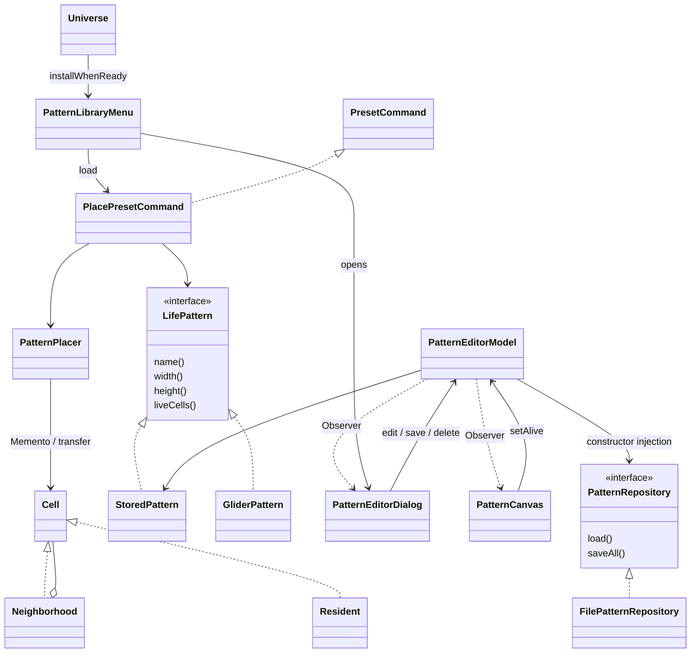
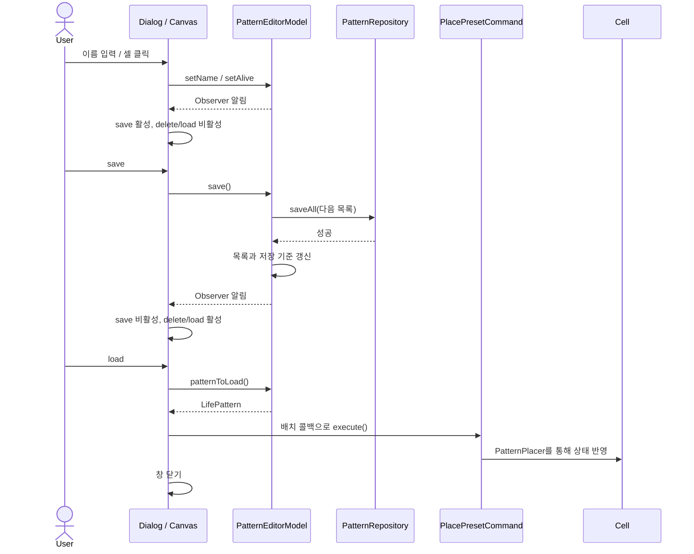

# Holub Life: 사용자 패턴 라이브러리 개선

작성일: 2026-11-24 (Asia/Seoul)

## 1. 비교 기준

| 단계 | 확인한 소스 | 기능 |
| --- | --- | --- |
| 초기버전 | Desktop/Eclipse/HolubLife/com/holub | 셀 클릭, Go, Grid 저장·불러오기. Patterns 없음 |
| 1차 개선 | 제공된 HolubLifePatterns-Eclipse/HolubLifePatterns | Glider, Blinker, Block, Toad 선택 → 보드 초기화 후 중앙 배치 |
| 최종 개선 | 이번 수정본 | Patterns 클릭 → 별도 창에서 임의 패턴 작성·수정·저장·삭제·불러오기 |

기존 정리: https://app.notion.com/p/41c9ed5ab45280ea84b4fcf0e85518c0

실제 초기 소스와 1차 개선 소스를 비교했다. 저장소 main의 초기 소스(1b9559e)도 비교 기준과 일치한다. Conway 규칙과 기존 Grid/Go 기능은 유지한다. 초기버전부터 누적한 변경과 이번 추가 개선을 아래에서 구분한다.

## 2. 요구사항과 실제 동작

상단 Patterns를 한 번 누르면 별도 모달 창이 열린다. 상단 64×64 격자, 그 아래 이름 입력란, 하단 왼쪽 스크롤 목록, 오른쪽 load / delete / save를 배치했다. 첨부 스케치의 순서와 영역 구성을 따른다. 창을 열면 시뮬레이션을 정지하고, 편집 중 메인 창 조작은 차단한다.

| 요구사항 | 구현 |
| --- | --- |
| 기존 프로그램처럼 패턴 찍기 | 왼쪽 클릭으로 셀 토글. 드래그는 시작 셀에서 정한 상태를 지나가는 셀에 적용 |
| 목록에서 기존 패턴 선택 | 편집기 중앙에 모양을 표시하고 이름도 함께 로딩 |
| new... 항목 | 항상 첫 항목. 선택하면 이름과 격자를 비운 신규 상태 |
| 변경 없으면 save 비활성 | 이름·전체 셀을 선택/저장 당시 값과 비교 |
| 변경되면 save 활성 | 이름 또는 셀 변경 시 활성. 정확히 원복하면 다시 비활성 |
| 저장 패턴 선택 시 delete 활성 | 저장 항목이며 수정사항이 없을 때 활성 |
| 수정 시 delete 비활성 | 이름·셀 중 어느 하나가 변경되어도 비활성 |
| 임의 패턴 저장·불러오기 | XML로 저장하여 재실행 후에도 유지 |

목록 선택은 편집기 미리보기이다. **load는 선택한 저장 패턴을 메인 보드에 배치**한다. 수정 중이면 먼저 save를 눌러야 load할 수 있다. load 성공 시 기존 보드를 지우고 중앙 배치한 뒤 창을 닫는다. 이후 기존 Go 메뉴로 실행한다.

기본 네 패턴도 수정·삭제할 수 있다. save는 기존 항목 선택 중이면 해당 항목을 갱신하고, new...이면 새 항목을 추가한다. 이름 앞뒤 공백은 저장할 때 제거한다. 빈 이름, 중복 이름(대소문자 무시), 예약 이름 new..., 80자를 넘는 이름, 제어문자, 살아 있는 셀이 없는 모양은 오류로 거절하며 편집 내용을 유지한다.

다른 패턴으로 이동하거나 창을 닫을 때 미저장 변경이 있으면 **저장 / 저장하지 않기 / 취소**를 표시한다. 사용자 추가 요청에 따라 “변경 버리기” 문구를 “저장하지 않기”로 변경했다. 저장 실패 또는 취소 시 현재 편집을 유지하고, 저장하지 않기는 미저장 변경을 반영하지 않고 요청한 이동/닫기를 수행한다. delete 전에는 삭제 확인을 표시한다.

| 상태 | save | delete | load |
| --- | --- | --- | --- |
| new... 선택 직후 | 비활성 | 비활성 | 비활성 |
| 신규 편집 중 | 활성 | 비활성 | 비활성 |
| 저장 패턴 선택 직후 | 비활성 | 활성 | 활성 |
| 저장 패턴 수정 중 | 활성 | 비활성 | 비활성 |
| 저장 상태로 정확히 원복 | 비활성 | 활성 | 활성 |
| 저장 성공 | 비활성 | 활성 | 활성 |
| 삭제 성공 | new...의 초기 상태 | 비활성 | 비활성 |

## 3. 초기버전 대비 누적 변경

기존 Java 파일 수정은 두 곳이다. 이번 단계에서는 Universe만 추가 변경하고, 1차 개선의 Neighborhood 보완은 그대로 유지했다.

| 기존 파일 | 초기버전 → 최종버전 |
| --- | --- |
| src/com/holub/life/Universe.java | PatternLibraryMenu import 및 installWhenReady(this, outermostCell) 호출. UI·저장은 외부 패키지로 위임 |
| src/com/holub/life/Neighborhood.java | transfer()의 LOAD로 활성화된 셀이 경계에 있으면 rememberThatCellAtEdgeChangedState()로 인접 블록 계산에 반영. 1차 개선에서 적용한 보완 |

Life, Cell, Resident, Clock, Direction, Storable 및 기존 io/ui/tools/asynch Java 소스는 수정하지 않았다.

### 1차 개선에서 추가되어 그대로 유지되는 9개 파일

모두 src/com/holub/life/patterns/에 있다.

| 파일 | 책임 |
| --- | --- |
| LifePattern.java | 이름·크기·상대 생존 좌표 공통 규약 |
| GliderPattern.java, BlinkerPattern.java, BlockPattern.java, ToadPattern.java | 기본 네 모양 정의 |
| PatternFactory.java | 최초 기본 패턴 생성 |
| PatternPlacer.java | 유효성 검사, 중앙 좌표 계산, 보드 초기화 및 Memento 적용 |
| PresetCommand.java, PlacePresetCommand.java | 배치 요청의 객체화 |

### 이번에 추가한 7개 파일

| 파일 | 책임 |
| --- | --- |
| StoredPattern.java | 데이터 기반 불변 LifePattern. 이름·좌표 검증 및 방어적 복사 |
| PatternRepository.java | 저장소 계약 load / saveAll |
| FilePatternRepository.java | 버전 있는 UTF-8 XML 읽기·쓰기, 최초 기본 목록, 임시 파일 교체 |
| PatternEditorModel.java | 선택·이름·셀·변경 감지, 저장·삭제, 버튼 상태 |
| PatternCanvas.java | 격자 렌더링과 클릭·드래그 입력 |
| PatternEditorDialog.java | 첨부 스케치의 Swing 화면, 이벤트 및 미저장 확인 |
| PatternLibraryMenu.java | Patterns와 창 연결, Clock 정지 및 배치 Command 호출 |

테스트는 기존 PatternPresetTest를 유지하고 PatternEditorTest, FilePatternRepositoryTest를 추가했다. tools/TestLauncher.java와 tools/test.ps1로 설치된 Eclipse의 JUnit 5를 명령줄에서도 실행한다. run.bat은 JAVA_HOME을 지원하며 컴파일 실패 시에만 종료하도록 구성했다. README와 구현 문서를 추가·갱신했다. 개인 Eclipse 프로젝트 설정과 빌드 결과는 추가하지 않았다.

## 4. 설계패턴 적용 근거

### Observer — 새로 적용한 GoF 패턴

Subject는 PatternEditorModel, Observer는 PatternEditorDialog와 PatternCanvas이다. 모델이 PropertyChangeSupport로 변경을 알리면 화면이 버튼·목록·이름·격자를 갱신한다.

적용 이유: 이름 입력과 셀 클릭 이벤트마다 버튼 활성화 코드를 중복하면 한 경로에서 갱신이 누락되기 쉽다. 변경 감지와 버튼 규칙을 모델에 한 번 정의하고, 화면 요소가 동일한 상태를 관찰하게 했다. 모델에는 Swing 의존성이 없어 원복·저장 실패를 창 없이 검증할 수 있다.

### Command — 1차 개선 재사용

PresetCommand와 PlacePresetCommand가 요청을 객체화한다. PatternLibraryMenu의 load 콜백이 호출하며 실제 배치는 PatternPlacer가 담당한다.

적용 이유: 고정 메뉴를 편집 창으로 바꿔도 배치 알고리즘을 복사하거나 UI 이벤트 안에 다시 작성하지 않는다. StoredPattern도 LifePattern을 구현하여 같은 명령으로 배치된다. 저장·삭제까지 불필요하게 Command 클래스로 늘리지는 않았다. Undo나 명령 이력은 구현하지 않았다.

### Repository — 새 저장소 분리 패턴

PatternRepository를 PatternEditorModel 생성자에 주입하고, FilePatternRepository가 파일 저장을 구현한다. 테스트에서는 메모리 저장소와 실패하는 저장소로 교체한다.

적용 이유: UI에서 파일 경로·XML·실패 처리를 직접 다루지 않게 하고, 저장 실패 시 편집 보존을 실제 파일 권한에 의존하지 않고 검증하기 위해서다. 저장 형식을 바꾸어도 모델의 호출 계약을 유지할 수 있다. Repository와 생성자 주입은 GoF 23개 패턴과 구분한다.

### MVC 형태의 책임 분리 — 아키텍처 구성

Model은 PatternEditorModel, View는 Dialog/Canvas의 Swing 컴포넌트, Controller는 Dialog의 이벤트 처리이다. 별도 Controller 클래스를 만들지는 않았다. MVC를 추가 GoF 패턴으로 세지 않는다.

### Composite·Memento — 기존 구조 재사용

Cell을 Resident와 Neighborhood가 구현하는 Composite를 유지한다. PatternPlacer는 Cell.Memento와 transfer()를 사용하여 내부 private grid에 접근하지 않는다. 이 Memento는 원래 상태 전달 기능을 재사용한 것으로 새로운 Undo를 의미하지 않는다. 편집 모델의 BitSet 스냅샷은 변경 비교용 값 복사이며 별도의 완전한 GoF Memento 구현이라고 주장하지 않는다.

### Simple Factory와 데이터 기반 확장

PatternFactory는 최초 기본 네 패턴 공급을 맡는다. 사용자 패턴은 이름·크기·좌표를 StoredPattern으로 구성하므로 매번 enum과 switch를 추가하지 않는다. 기본 패턴 종류를 코드로 늘릴 때는 Factory 수정이 필요하다. Simple Factory는 GoF Factory Method와 다르다.

## 5. 선택 이유와 대안

| 선택 지점 | 채택 및 근거 | 한계 |
| --- | --- | --- |
| 사용자 모양 | 데이터형 StoredPattern으로 기존 LifePattern과 호환 | 크기 최대 64×64 |
| 변경 감지 | 이름과 전체 격자의 스냅샷 비교. 단순 dirty=true 플래그와 달리 원복 감지 | Undo 이력은 없음 |
| 저장 영역 | 생존 셀의 최소 경계로 잘라 상대 좌표화 | 편집기 내 절대 위치와 빈 주변 여백은 저장하지 않음 |
| 저장 형식 | 표준 Properties XML, version=1. 추가 의존성 없이 한글과 좌표 보존 | 기존 Grid의 .life와 별도 형식 |
| 파일 갱신 | 같은 폴더 임시 파일 작성 후 교체. 기존 파일을 먼저 지우지 않음 | ATOMIC_MOVE 미지원이면 일반 REPLACE_EXISTING 사용 |
| 오류 처리 | 손상 파일은 오류를 표시하고 열기를 중단 | 자동 복구·초기화 기능은 없음 |
| 통합 | Universe 한 줄 설치 호출, 기존 MenuSite API 수정 없음 | Swing 프레임 부착 후 메뉴 설치 |
| 편집 창 | 모달로 메인 보드 동시 조작 방지 | 여러 편집 창 동시 사용은 없음 |

저장·삭제는 다음 목록을 따로 구성하고 저장소가 성공한 뒤에만 현재 목록과 저장 기준을 바꾼다. 실패하면 선택, 입력 이름, 셀, 변경 상태를 유지한다. 패턴 이름은 파일명이 아니라 XML 데이터로 저장하므로 경로 문자가 저장 위치를 바꾸지 않는다.

저장 경로: `${user.home}/.holub-life/patterns.xml`. `-Dholub.life.patterns.file=경로`로 테스트 파일을 지정한다. 파일이 없을 때만 기본 네 패턴을 공급한다. 빈 목록이 저장되어 있으면 모두 삭제한 결과로 유지한다. 최대 1000개, 파일 16MB 제한을 둔다. 동시 실행한 여러 프로세스 사이의 목록 병합은 구현하지 않았다.

## 6. UML

## 7. 검증 결과

JDK 22에서 운영 소스를 `--release 8`로 컴파일했다. Eclipse에 설치된 JUnit Jupiter 5.11.4 / Platform 1.11.4로 **39개 발견·실행·성공, 실패 및 건너뜀 0개**를 확인했다. README의 테스트 명령으로 재현할 수 있다.

| 테스트 | 개수 | 내용 |
| --- | ---: | --- |
| PatternPresetTest | 12 | 기본 셀 수·중앙 좌표, 보드 교체, Glider 이동·블록 경계, 진동·안정 패턴, 기존 마우스·Memento, Command·예외 |
| PatternEditorTest | 19 | 선택·new·수정·원복 버튼 상태, 저장·이름 변경·삭제, 입력 검증, 실패 시 보존, Observer, 임의 패턴 배치, 방어적 복사, 클릭·드래그·경계 |
| FilePatternRepositoryTest | 8 | 기본 목록, 한글·좌표 왕복, 빈 목록, 기본 패턴 수정·삭제, 손상·버전·좌표 거절, 중복 이름 원본 보존, 교체 실패 임시 파일 정리 |

실제 Swing 앱에서도 별도 Patterns 창과 레이아웃, new... 초기 버튼 상태, 기존 패턴 수정 중 save 활성과 delete/load 비활성, 미저장 확인 창을 시각적으로 확인했다. 저장·재로딩·삭제 실패는 자동 테스트로 검증했다. 모든 경로를 UI 자동 클릭으로 수행한 것은 아니다.

기존 MenuSite의 deprecated API와 원본 raw type 경고는 남아 있다. 회전·반전·Undo·중첩 배치·임의 위치 배치·외부 RLE 가져오기는 범위 밖이다.

## 8. 병합 안내

이 브랜치는 초기 main(1b9559e)에서 시작하여 프리셋 기능과 사용자 편집 기능을 함께 포함한다. 다른 기능 브랜치를 미리 복사하지 않고 이 브랜치를 main에 병합한다.

초기버전에 수동 통합할 때:

1. src/com/holub/life/patterns의 최종 Java 파일 16개를 추가한다.
2. Universe에 PatternLibraryMenu import와 installWhenReady 호출을 통합한다. 다른 팀의 Universe 수정 전체를 덮어쓰지 않는다.
3. Neighborhood.transfer의 LOAD 경계 활성화 보완도 반영한다.
4. 1차 프리셋 메뉴 등록 루프가 있다면 제거하여 이중 메뉴를 막는다.
5. test의 세 파일을 추가하고 JUnit 5로 검증한다.

1차 개선판과 비교하면 신규 Java 파일 7개와 Universe 연결이 추가 변경분이다. Neighborhood와 기존 패턴 파일 9개는 1차 개선판과 같다. 다른 팀원도 Universe나 Neighborhood를 수정했다면 양쪽 변경을 유지하여 통합한다. 빌드 결과, 테스트 데이터, 개인 저장 목록은 이 기능의 커밋에서 제외한다. 저장소에 기존부터 있던 컴파일 파일도 이번 변경에서는 수정하지 않으며, 실행 전에는 src를 새로 컴파일한다.
